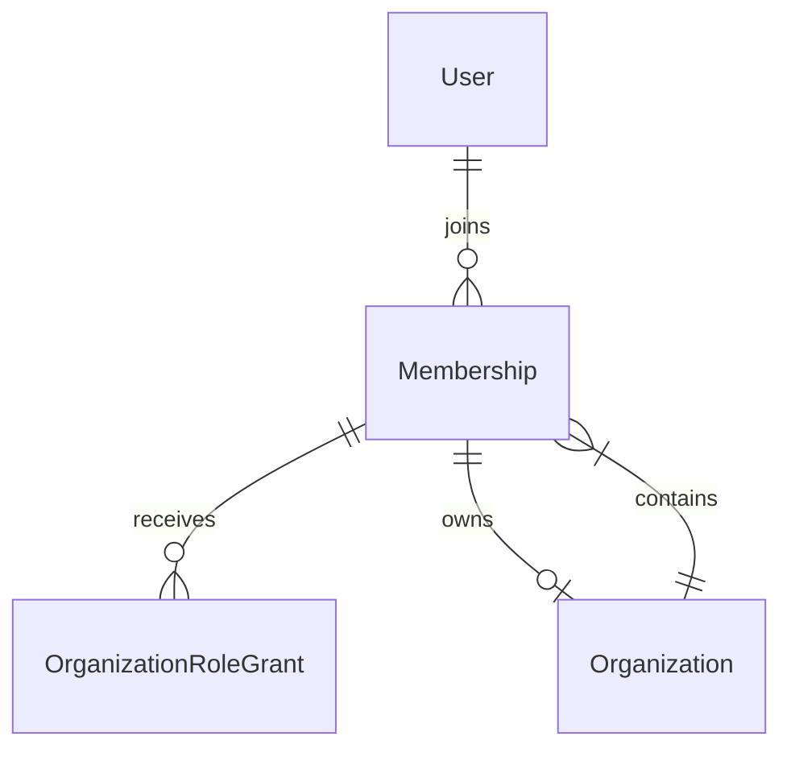

# DF-008: identity and organization persistence

## Shipped scope

Adds Prisma models and the first reviewed PostgreSQL migration for User, Organization, Membership and OrganizationRoleGrant. Adds an internal OrganizationRepository for verified-user workspace creation and scoped own-membership lookup. No registration, login, invitation, membership administration or public organization endpoints are exposed; those need session guards and audit/reauthentication flows from subsequent tasks.

A global user may join several organizations. Each membership belongs to exactly one organization and user. OWNER is derived from Organization.ownerMembershipId, not a grant that can be duplicated or assigned by a request. Project/team/report grants remain future feature models; the present enum contains only organization-level ADMIN, HR, PROJECT_MANAGER, EMPLOYEE and VIEWER. An EMPLOYEE grant is added to the initial owner for self-service work features.

## Database guarantees

- UUID identifiers; UTC timestamptz fields; unique normalized email and membership `(organizationId,userId)`.
- Email must be lowercase and trimmed at the database boundary. Full email syntax validation/normalization belongs to DF-009. PasswordHash is nullable for pending identity records, not an empty-password login path; no login exists yet.
- Organization name and user display name cannot be blank; authVersion is nonnegative.
- Composite membership identity `(organizationId,id)` is referenced by both owner pointers and role grants, rejecting cross-organization links even through direct SQL.
- Owner pointers are non-null. Their FK is DEFERRABLE INITIALLY DEFERRED so organization and membership can be inserted atomically in one transaction. Missing or foreign owners fail at commit.
- Deferred constraint triggers require the final owner membership to be ACTIVE. A membership-status trigger locks its organization row, serializing status changes with owner changes. The owner cannot be suspended/removed while still owning the workspace. Ownership-transfer and grant-administration services are not implemented here.
- Restrictive deletes prevent silently orphaning memberships/grants. No account/organization deletion endpoint or cascading user-data purge is introduced.

The initial SQL migration contains deferred constraints, CHECKs and triggers that Prisma's schema alone does not fully describe. Preserve those manually authored parts in future migration reviews. `db push` is not an acceptable replacement for versioned migrations. Database ownership/admin credentials can alter these controls; least-privilege runtime roles remain a deployment gate.

## Internal repository boundary

`createForVerifiedUser` validates a trimmed name, locks the actor's user row, confirms active/verified identity, preallocates organization/member UUIDs, and inserts organization, membership and employee grant in one transaction. Concurrent user-status changes serialize against the user lock. Any failure rolls the transaction back. A future public onboarding service must add the required audit entry within this transaction before exposing the operation.

`findOwnMembership` filters by actor user ID, organization ID, active membership, active verified user and active organization in one query. It returns a small identity/role projection without email/password/security fields. Missing, foreign and inaccessible workspaces share a generic 404. This is own-membership persistence, not a complete authorization engine or directory endpoint. Future guards must supply an authenticated actor ID; never bind it from request payloads. Role grants in the returned context are not permission checks for unrelated actions.

## Migration workflow

From the root, `npm run db:deploy` applies committed migrations using DIRECT_URL; `npm run db:status` checks migration history. These commands never run automatically at API startup. Confirm the target is the intended development database before running deploy. This migration creates new tables/types/functions only; it does not seed users, drop objects or reset data. Future migrations require separate SQL review and appropriate backup/restore planning.

CI supplies a disposable PostgreSQL database and DIRECT_URL, applies migrations, checks status, then runs integration tests. The mutating integration suite accepts only TEST_DATABASE_URL with a database name ending in `_test`, never DATABASE_URL/DIRECT_URL or the developer's Neon `neondb`. Fixtures use random UUIDs and example.test emails; cleanup deletes only the suite's own IDs in a transaction. Local runs without TEST_DATABASE_URL explicitly skip these tests; skipped tests are not a successful database verification.

## Acceptance and verification

The integration suite covers atomic creation and safe projections; cross-tenant selectors; disabled/unverified users; name validation; concurrent duplicate email creation; database normalization checks; duplicate memberships/grants; cross-tenant role and owner links; rollback with missing owner; inactive owner rejection; suspended/removed memberships; archived organizations; and fresh user-state checks. Existing health and readiness tests remain intact. CI verifies migration deployment against real PostgreSQL and then frontend/browser compatibility. Neon migration application and current test results are recorded below after execution.

## Verification record: 2026-10-18

Implementation commit `3d14242` passed GitHub Actions run `39045642569`: migration deployment/status, all 50 API tests (including the 15 live PostgreSQL tests), frontend production build, dependency audit and all 20 desktop/mobile Chromium tests. Local formatting/lint/type checks passed; the local API run passed 35 tests with 15 database tests explicitly skipped.

Applied `202610170001_identity_organizations` to the configured Neon development database after CI succeeded. `npm run db:status` reports the schema up to date. Read-only inventory confirmed User, Organization, Membership, OrganizationRoleGrant and Prisma migration history tables; user/organization/membership counts were all zero. No synthetic fixtures or account credentials were inserted into Neon. PR #8 remains open and unmerged.
